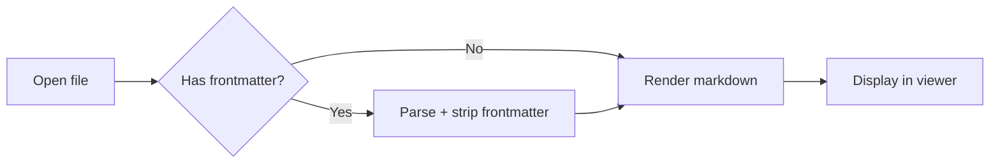
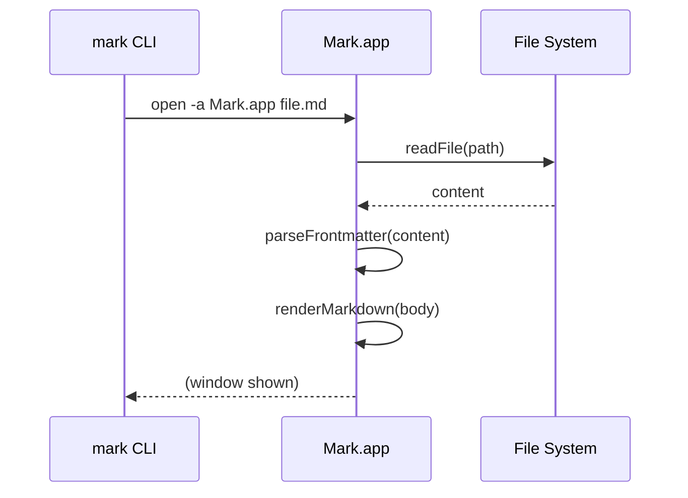
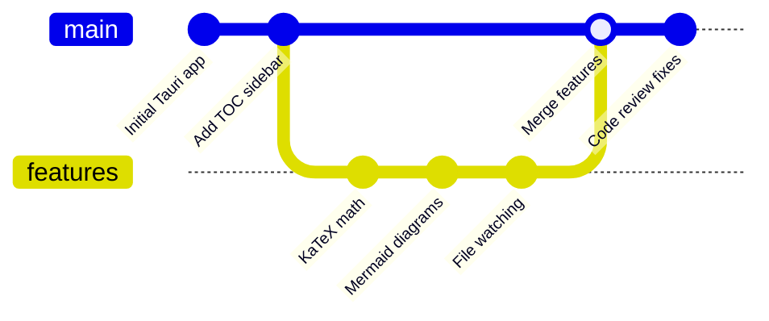

# Mark Feature Test

This document exercises every feature implemented in this session. Open it with `mark test-all-features.md` or drag and drop.

---

## 1. GFM Task Lists

- [x] File watching / auto-reload
- [x] Scroll position memory
- [x] Quick Open ⌘P
- [x] KaTeX math rendering
- [x] Mermaid diagrams
- [x] Frontmatter display
- [x] Export to PDF
- [x] Pipe support (`mark -`)
- [x] Directory browser (`mark .`)
- [x] Custom CSS injection
- [x] VSCode theme import
- [x] Read ↔ Edit toggle (⌘E) and save (⌘S)

---

## 2. GFM Tables

| Feature | Shortcut | Status |
|---|---|---|
| Open file | ⌘O | ✅ |
| Quick Open | ⌘P | ✅ |
| Toggle edit | ⌘E | ✅ |
| Save | ⌘S | ✅ |
| Find | ⌘F | ✅ |
| Export PDF | ⌘⇧E | ✅ |
| Toggle sidebar | ⌘\ | ✅ |
| Auto-reload | ⌘⇧R | ✅ |
| Settings | ⌘, | ✅ |

---

## 3. GFM Strikethrough

The old Swift app is ~~dead~~ retired. The new Tauri version is faster, lighter, and cleaner.

~~This line should appear crossed out.~~

---

## 4. Frontmatter

The block at the top of this file (between the `---` delimiters) should be visible as a collapsible metadata block above this content. It contains `title`, `author`, `date`, `version`, and `tags`.

Toggle it off in Settings → Display → Show frontmatter.

---

## 5. KaTeX Math

### Inline math

Einstein's mass-energy equivalence: $E = mc^2$

Euler's identity: $e^{i\pi} + 1 = 0$

The quadratic formula: $x = \frac{-b \pm \sqrt{b^2 - 4ac}}{2a}$

### Block math

The Gaussian integral:

$$\int_{-\infty}^{\infty} e^{-x^2} dx = \sqrt{\pi}$$

Maxwell's equations (Gauss's law):

$$\nabla \cdot \mathbf{E} = \frac{\rho}{\varepsilon_0}$$

The Schrödinger equation:

$$i\hbar \frac{\partial}{\partial t} \Psi(\mathbf{r}, t) = \hat{H} \Psi(\mathbf{r}, t)$$

---

## 6. Mermaid Diagrams

### Flowchart



### Sequence diagram



### Git graph



---

## 7. Code Blocks (Copy Button)

Hover over any of these to see the copy button.

```bash
# Open a file
mark README.md

# Watch mode (auto-reload on save)
mark -w README.md

# Open a directory
mark .

# Pipe stdin
cat README.md | mark -
echo "# Hello" | mark -
```

```rust
#[tauri::command]
fn start_watch(
    path: String,
    app: tauri::AppHandle,
    watcher_state: tauri::State<ActiveWatcher>,
) -> Result<(), String> {
    // 300ms debounce to handle atomic writes from editors
    let debouncer = new_debouncer(Duration::from_millis(300), move |res| {
        if res.is_ok() {
            let _ = app.emit("file-changed", &path);
        }
    })?;
    Ok(())
}
```

```javascript
// KaTeX marked extension
{
  name: 'mathInline',
  level: 'inline',
  tokenizer(src) {
    const match = src.match(/^\$([^$\n]+?)\$/);
    if (match) return { type: 'mathInline', raw: match[0], text: match[1] };
  },
  renderer(token) {
    return katex.renderToString(token.text, { displayMode: false });
  },
}
```

---

## 8. Blockquotes

> A markdown viewer should get out of the way.
> Fast to open, fast to read, nothing more.

> **Note:** Scroll position is saved per file. Close this file, open another, then come back — you'll land exactly where you left off.

---

## 9. Scroll Position Memory

This document is intentionally long so you can test scroll memory. Scroll down to this section, close the file (⌘W or open a different one), then reopen it. The viewer should restore your position here.

Lorem ipsum dolor sit amet, consectetur adipiscing elit. Sed do eiusmod tempor incididunt ut labore et dolore magna aliqua. Ut enim ad minim veniam, quis nostrud exercitation ullamco laboris nisi ut aliquip ex ea commodo consequat.

Duis aute irure dolor in reprehenderit in voluptate velit esse cillum dolore eu fugiat nulla pariatur. Excepteur sint occaecat cupidatat non proident, sunt in culpa qui officia deserunt mollit anim id est laborum.

---

## 10. Images


---

## 11. Nested Lists

- Viewer features
  - Frontmatter display (collapsible)
  - Mermaid diagrams (theme-aware)
  - KaTeX math (inline + block)
  - GFM tables, task lists, strikethrough
- CLI features
  - `mark <file>` — open a file
  - `mark -w <file>` — watch mode
  - `mark .` — directory browser
  - `mark -` — pipe from stdin
- Settings
  - Theme: system / light / dark
  - Font size: small → x-large
  - Content width: narrow → full
  - Copy button toggle
  - Frontmatter toggle
  - Custom CSS

---

## 12. Custom CSS

Open Settings (⌘,) and paste this into the Custom CSS field to try it:

```css
.markdown-body {
  font-family: Georgia, 'Times New Roman', serif;
}

.markdown-body h1,
.markdown-body h2 {
  font-family: -apple-system, BlinkMacSystemFont, sans-serif;
}
```

---

## 13. PDF Export

Press **⌘⇧E** to export this document as PDF. The sidebar, search bar, and copy buttons are hidden in the print output. The content width expands to fill the page.

---

*End of feature test document.*
